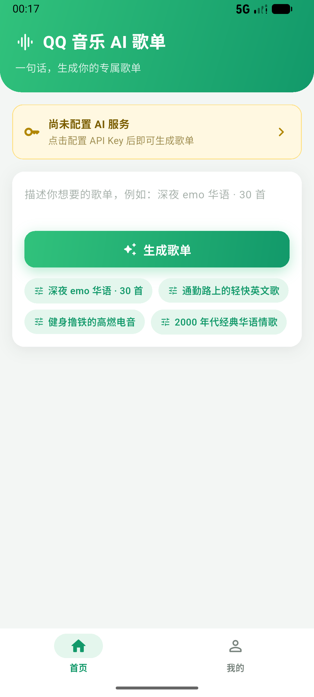
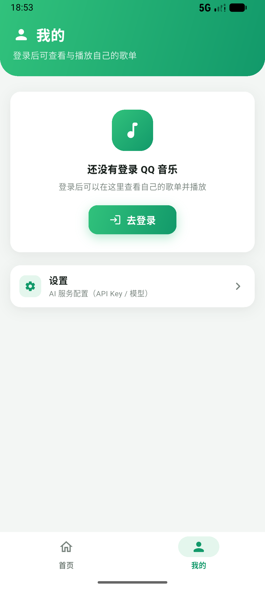
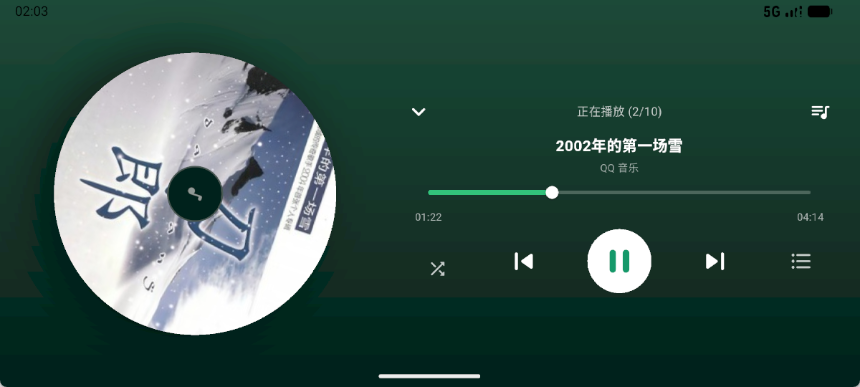

<div align="center">

# 🎵 QQ 音乐 AI 歌单

**一句话，生成你的专属歌单**

用 AI 根据心情/场景生成歌单 → 自动匹配 QQ 音乐曲库 → 一键创建或播放

[](https://flutter.dev)
[](#)
[](LICENSE)

</div>

---

## ✨ 功能

- 🤖 **AI 生成歌单** — 接入任意 OpenAI 兼容服务（DeepSeek / Kimi / 智谱 GLM / 通义 Qwen / GPT-4o 等），一句话生成个性化歌单
- 🔍 **曲库匹配** — 自动匹配 QQ 音乐曲库，逐首实时显示匹配状态
- ▶️ **在线播放** — 内置完整播放器：旋转黑胶封面、可拖动进度条、播放模式（列表循环 / 单曲循环 / 顺序 / 随机）、播放列表队列
- 📱 **系统媒体控制** — 通知栏 / 锁屏 上一首 · 播放暂停 · 下一首，后台播放不中断
- 💾 **状态持久化** — 播放队列、进度、播放模式重启后恢复；播放链接本地缓存（本地优先）
- 📝 **歌单管理** — 查看自己创建与收藏的歌单，支持改名、删除，支持「加入已有歌单」
- 🖥 **横竖屏自适应** — 播放页横屏自动切换左右布局

## 📸 截图

| 首页 | 我的 | 播放页（横屏） |
|---|---|---|
|  |  |  |

## 📥 下载

前往 [Releases](../../releases) 页面下载：

- **Android**：`app-arm64-v8a-release.apk`（大多数现代手机）/ `armeabi-v7a` / `x86_64`
- **Windows**：`qq_music_ai-windows-x64.zip`（解压后运行 `qq_music_ai.exe`）

> APK 使用 debug 签名，安装时需允许「未知来源应用」。

## 🛠 从源码构建

```bash
git clone https://github.com/OxOld/qq_music_ai.git
cd qq_music_ai
flutter pub get

# Android
flutter build apk --release --split-per-abi

# Windows
flutter config --enable-windows-desktop
flutter build windows --release
```

要求：Flutter 3.41.x（stable）、JDK 17（Android）、Visual Studio 2022 桌面开发负载（Windows）。

> 💡 国内网络建议为 Gradle 配置镜像源与超时参数（见 `android/settings.gradle.kts` 与 `android/gradle.properties`，项目已内置国内镜像与防挂起配置）。

## ⚙️ 使用说明

1. 首次使用进入「我的 → 设置」，配置 **OpenAI 兼容服务**的地址与 API Key（Key 仅保存在本机安全存储中，直连对应服务）
2. 「我的 → 登录」扫码登录 QQ 音乐（匹配、播放、创建歌单需要登录态）
3. 首页输入一句话（如「深夜 emo 华语 · 30 首」）生成歌单
4. 匹配曲库后可「创建新歌单」或「加入已有歌单」，也可直接播放

> ⚠️ 匹配与播放使用 QQ 音乐网页版接口，部分歌曲受会员/版权限制无法获取播放链接，属于正常现象。

## 🧩 技术栈

- [Flutter](https://flutter.dev) 3.41 · Dart 3.11 · Material 3
- [flutter_riverpod](https://pub.dev/packages/flutter_riverpod) — 状态管理
- [just_audio](https://pub.dev/packages/just_audio) + [audio_service](https://pub.dev/packages/audio_service) — 播放与系统媒体会话
- [flutter_inappwebview](https://pub.dev/packages/flutter_inappwebview) — QQ 音乐扫码登录
- [flutter_secure_storage](https://pub.dev/packages/flutter_secure_storage) — Key 与登录态安全存储

项目结构：

```
lib/
├── main.dart            # 入口（后台播放初始化）
├── theme/               # 主题（品牌绿 + 卡片风）
├── models/              # 数据模型
├── providers/           # Riverpod providers
├── services/            # QQ 音乐客户端 / LLM / 播放器 / 登录态 / 匹配
├── widgets/             # 迷你播放条 / Toast
└── pages/               # 首页 / 我的 / 播放页 / 歌单详情 / 登录 / 设置
```

## 🙏 鸣谢

- [simple-music](https://github.com/Yyyangshenghao/simple-music) — QQ 音乐网页版接口（musicu.fcg / fcg_user_created_diss / CgiGetDiss 等）的调用方式与参数形状参考
- [QQ 音乐网页版](https://y.qq.com) — 接口来源；本项目的曲库匹配、歌单读写、播放链接均基于其 Web 端协议
- [Flutter](https://flutter.dev) 与开源社区 — [just_audio](https://pub.dev/packages/just_audio) / [audio_service](https://pub.dev/packages/audio_service) / [flutter_inappwebview](https://pub.dev/packages/flutter_inappwebview) / [flutter_riverpod](https://pub.dev/packages/flutter_riverpod) 等优秀库
- 感谢所有逆向协议与开源工具链贡献者的长期积累

## ⚠️ 免责声明

- 本项目仅供 **个人学习与研究** 使用，请勿用于商业用途
- 项目不存储任何音乐文件，播放能力依赖 QQ 音乐官方接口与用户自身的会员权益
- 使用本项目产生的任何问题由使用者自行承担，与作者无关
- 如有侵权请联系删除

## 📄 License

[MIT](LICENSE)
